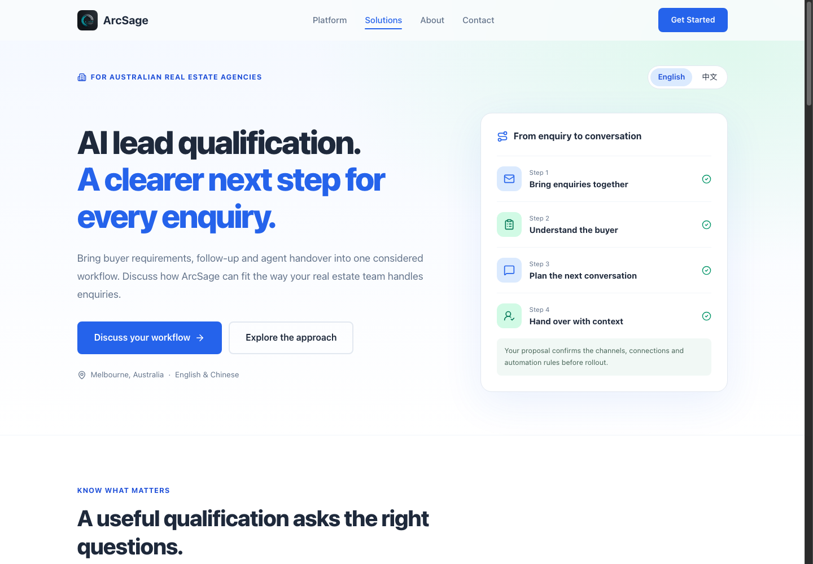

# ArcSage website and experiments

The active website lives in `v2/`. It shares one React navigation, visual system, logo and product screenshots. The root Vite configuration builds that version; root legacy components and v1 are retained historical source.

The site now builds actual HTML for the homepage, About, Contact, English/Chinese lead-qualification pages, and a buyer evaluation guide. Page titles, descriptions, language, canonical URLs, an organization identity record and a sitemap are generated consistently. Unknown routes have a real not-found page. JavaScript hydrates the same React components; essential service content is available before scripts run.

## Build and verify

```sh
npm ci --ignore-scripts --no-audit --no-fund
npm test
npm run build
npm run check:static
python3 -B -m unittest discover -s experiments -p 'test_analysis.py' -q
python3 -B -m unittest discover -s experiments/collector -p 'test_collector.py' -q
```

Node 22 and Python 3.12 are used in the review CI. The browser assignment tests use Node's built-in runner; the collector and analysis use Python's standard library. No paid AI API is required for these checks.

Preview actual built routes:

```sh
python3 -m http.server 8000 --bind 127.0.0.1 --directory dist
```

## Real contact CTA A/B test

The browser test varies one factor on `/contact`: A **Email us**, B **Discuss lead qualification**. Factual copy, destination and layout are shared. Assignment uses a cryptographically random browser ID/variant stored for repeat visits. Exposure is recorded only after the client restores its assignment; a click records contact intent. Events use retained IDs and ordered retry transport.

The endpoint stores actual exposures and intents in SQLite, deduplicates retries, excludes conflicting visitors and protects its administrative report. An empty store has no seeded outcomes. The contact action opens the visitor's email application and does not pretend a message was delivered.

**The A/B feature defaults off.** Activation needs a collector endpoint with durable storage, the actual site origin configured there, and the locked measurement plan reviewed before public enrolment. Preview QA uses a separate disposable store and is not mixed with customer data.

See [collector and hosting instructions](experiments/collector/README.md), [experiment plan](experiments/contact-cta-v1/plan.json), and [analysis instructions](experiments/README.md). SQLite needs a suitable persistent local disk; this implementation is not a durable Cloud Run backend.

## SEO and GEO effectiveness

Readable HTML, useful buying information and correct route responses improve technical access. They do not guarantee indexing or AI citations. The visitor A/B test measures contact intent; public AI discovery needs a separate fixed-question, repeated observation protocol. That research, baseline, change records, reviews and source catalog are maintained in [the GEO repository](https://github.com/winstonpgao/GEO).

New page copy uses documented service positioning and avoids invented performance figures, prices or testimonials. Existing legacy marketing assertions are not verified by this website build. Keep their product evidence review separate from whether the code renders.

## Release behavior

Pushes to `main` run the existing GitHub Pages deployment. Review branches and draft pull requests contain source improvements without publishing them. The review workflow builds and verifies code on the pull request. Record the release commit and actual public HTTP/crawl evidence before calling an intervention deployed.


